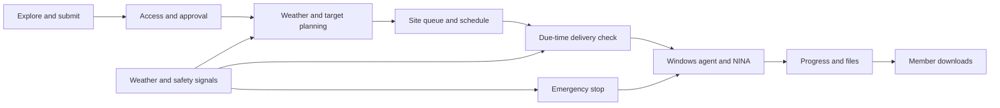

# Pomfret Astro Network

**More of the sky. Within reach.**

Pomfret Astro is software for operating independent observatories. People explore the sky, request observations, and receive their data; each observatory retains control of its equipment, schedule, members, and access rules. The project began at Pomfret School’s Olmsted Observatory to make a telescope useful even when an experienced operator cannot be on site every night. The Network extends that operating model to multiple sites without requiring them to share ownership or telescope time.

[Production website](https://www.pomfretastro.org) · [Product definition](docs/pomfret-astro-network.md) · [Multi-site checklist](docs/multi-site-checklist.md)

This repository contains the website, scheduling and safety services, NINA agent, all-sky camera software, tests, and deployment configuration for **version 10.0.0**. It documents the current implementation and distinguishes it from the longer-term Network vision.

## Contents

- [Purpose and operating model](#purpose-and-operating-model)
- [Current capabilities](#current-capabilities)
- [An observing night](#an-observing-night)
- [Architecture and repository guide](#architecture-and-repository-guide)
- [Sites, identity, and access](#sites-identity-and-access)
- [Scheduling and observing rules](#scheduling-and-observing-rules)
- [Weather, readiness, and safety](#weather-readiness-and-safety)
- [NINA execution and data delivery](#nina-execution-and-data-delivery)
- [Operations and configuration](#operations-and-configuration)
- [Development and verification](#development-and-verification)
- [Scope and direction](#scope-and-direction)

## Purpose and operating model

Observatories are often underused because coordinating observers, weather, equipment, and data handoff takes human time. Pomfret Astro puts those steps in one workflow. It aims to make remote observing practical for a school or another independently operated site, while leaving operational authority with its operator.

1. **Independent ownership.** A site keeps its telescope, hardware decisions, users, and governance. Joining the Network does not transfer control.
2. **Coordinated access.** The software accepts requests from multiple people, applies site-specific permissions, schedules feasible work, and shows progress. A site may remain private.
3. **Connection by choice.** Operators may allow access from members of other observatories. Broader sharing of available telescope capacity is a product direction, not a claim that every site offers it today.

The current site catalog includes **Pomfret** and **Cygnus**. Each has its own location, timezone, schedule strip, weather configuration, and data namespace. Hardware features depend on the site: Pomfret’s all-sky camera and North American GOES view are not assumed to exist at Cygnus.

## Current capabilities

| Area | Available now |
| --- | --- |
| Explore | Plan atlas with target search, framing and mosaic tools, and Classic DSS, Hα, HBR, and OHS imagery views. Coverage and appearance depend on upstream survey data. |
| Request | Remote submissions for single-night deep-sky and variable-star imaging; multi-night projects track remaining frames across nights. |
| Coordinate | Site-scoped queue, tonight’s schedule, member permissions, admin approvals, project progress, and audit trail. |
| Decide | Server-side weather, target altitude, Moon separation, planned-start, and availability checks at scheduling and NINA delivery. |
| Observe | A Windows agent receives a job envelope, fills NINA templates, operates configured local equipment, reports progress, and executes emergency or end-night sequences. |
| Deliver | Session previews and output files in object storage, member downloads, history, and gallery metadata. |
| Monitor | Observatory status, agent heartbeat, mount telemetry, weather views, and Pomfret all-sky imagery with sky/rain inference. |

The Remote submission interface currently offers **DSO** and **variable star** session types. Historical code or records for other modes do not mean those modes are offered to members.

## An observing night



1. A member selects a site and target, then submits a single-night session or project. Site policy determines membership, imaging approval, and administrator-review requirements.
2. Reconciliation evaluates forecast weather, darkness, altitude, Moon avoidance where applicable, existing work, and sequence overhead. Feasible work receives a planned start. Other work remains pending or is held.
3. The site agent polls the server. Before releasing a due job, the server checks current weather and observatory state. Safety and an already-running NINA sequence take priority.
4. The agent prepares configured hardware, constructs a NINA sequence from templates, runs it, and reports progress. The board and remaining project work are updated.
5. Results are uploaded to Cloudflare R2 for authorized downloads. End-night may close the dome after work is exhausted. Emergency stop has a higher-priority closure path.

**A schedule is a plan, not a promise to open the dome.** The live delivery gate can refuse a previously scheduled job when conditions change.

## Architecture and repository guide

| Location | Responsibility |
| --- | --- |
| `app/`, `app/api/` | Next.js pages, dashboard, authentication, member/admin actions, and HTTP endpoints. |
| `components/` | Atlas, Weather, Remote, framing, account, and dashboard UI. |
| `lib/imaging/` | Queue, projects, reconcile, NINA delivery, emergency stop, and session lifecycle. |
| `lib/observatory-sites.ts`, `lib/observatory-site-scope.ts` | Site catalog and request-scoped observatory context. |
| `lib/tonight-weather-gate.ts`, `lib/asc-cloud.ts` | Forecast scheduling and live readiness rules. |
| `lib/imaging/weather-safety-estop.ts`, `lib/imaging/storm-observations.ts` | Automatic weather emergency-stop detection. |
| `lib/db/`, `lib/kv-rest.ts`, `lib/r2-session-download.ts` | Postgres, Redis REST, and object-download integration. |
| `observatory/nina_agent.py`, `observatory/nina_sequence_builder.py` | On-site Windows poller and NINA job construction. |
| `observatory/nina_templates/` | Sequence templates, including emergency stop and end night. |
| `observatory/camera_service.py`, `observatory/asc_cloud_ai.py` | Optional all-sky camera service and ASC AI v2 inference. |
| `AI Models/`, `observatory/models/` | Model documentation and site-side assets. |
| `docs/`, `.github/workflows/`, `scripts/` | Product/operations notes, CI, catalog refresh, migrations, and maintenance. |

The web application uses **Next.js 14, React 18, and TypeScript** on Vercel. Frequently updated imaging state lives in **Upstash Redis**; **Postgres** holds accounts, memberships, policies, gallery records, and longer-lived history; **Cloudflare R2** stores session files and previews. The Windows agent talks to the server over authenticated HTTP and to NINA and observatory hardware locally.

The website decides when and what to observe. Templates and the local agent turn a delivered job into NINA steps. A web deployment does **not** update the Windows agent or Raspberry Pi.

## Sites, identity, and access

The active site is selected through `?site=`, the `X-Observatory-Site` header, or a site cookie. Site-aware code uses that request context for astronomy calculations, display times, queue keys, and agent routes. Pomfret retains legacy unprefixed Redis keys; other sites use `site:<id>:` namespaces. The [multi-site checklist](docs/multi-site-checklist.md) covers the full site-addition procedure.

Members sign in with an HTTP-only session cookie. Accounts, memberships, and site policies live in Postgres; session tokens and active imaging state live in Redis. The access model distinguishes guests, site members, site administrators, and a global Pomfret Astro administrator. A user has one site affiliation, while another site can separately allow cross-observatory submissions. Policies govern guest access, imaging approval, duration limits, and admin review. Email verification is required to submit a session.

Site administrators manage their membership and imaging approvals, schedule closures, session actions, and emergency stop. The agent uses a queue credential, not a member login; cron and telemetry use separate credentials. Session downloads require the owner, an authorized administrator, or the explicit session access mechanism. Production secrets belong outside source control.

## Scheduling and observing rules

**Reconcile** is the scheduling engine. It evaluates the remaining usable night, maintains existing work, and walks eligible pending requests in submission order. It considers local dusk/dawn, target altitude across the *whole estimated session*, Moon separation, weather-permitted intervals, operator closures, occupancy, and project reservations. Planned starts are retained while valid and re-evaluated as conditions change. A scheduled row is not delivered before its planned start.

| Rule | Current behavior |
| --- | --- |
| Target altitude | At least **30° throughout the estimated session**, using the active site’s coordinates. |
| Weather coverage | At least **90%** of a normal candidate’s estimated duration must be weather-permitted. |
| Sequence overhead | DSO/project planning includes **60 min** base, **5 min** per additional filter, and **15 min** for a meridian flip. The variable-star queue path uses **30 min** base plus **15 min** for a flip. |
| Moon | Filter-dependent separation for ordinary imaging; a Moon below the horizon passes. Variable-star sessions skip Moon avoidance. |
| Projects | Remaining frames persist across nights. A current project may reserve its target’s observable time; other requests can use valid gaps. |
| Mosaics | Panels are planned as project work with remaining frames per panel. |
| Delivery | Site state, weather, planned start, altitude, reservations, and NINA-running status are checked again before handoff. |

Project planning may split useful clear intervals into multiple sub-sessions when the added exposure justifies its overhead. It may shrink frame counts to fit viable windows. Reservations are bounded by the target’s observable time and remaining planned work, rather than automatically occupying the full night. Failed work may be held for the rest of the night pending operator action. The schedule and audit log expose the reasons for placement, movement, holds, and refusal.

## Weather, readiness, and safety

The system makes **three distinct weather decisions**:

| Decision | Question | Current rules |
| --- | --- | --- |
| Tonight scheduling | Is there a viable plan? | Any forecast precipitation probability **≥80%** in an hour overlapping **civil sunset to sunrise** blocks the whole night. Otherwise, nautical-night hours require cloud **<10%**, precipitation probability **<10%**, and wind **≤10 m/s**. At least **two consecutive passing hours** must remain; no more than three over-limit wind hours are allowed before the cutoff. The first forecast hour with precipitation probability **≥10%** sets a normal-session finish cutoff **two hours before** that hour. |
| Live Ready | May the site accept work now? | If applicable, ASC sky must be clear with no rain; otherwise Open-Meteo cloud must be **<10%**. Open-Meteo wind must be **<10 m/s** and current precipitation probability **≤20%**. Site mode, daylight, maintenance, and agent/NINA state also affect operational status. |
| Weather-safety ESTOP | Must active operations stop? | During nautical night, observed thunder/lightning or official warnings, a surrounding storm forecast, site precipitation probability **>20%**, or sufficiently confident ASC rain can arm the emergency sequence. |

Weather-safety ESTOP has four signal paths:

- **Observed storms:** fresh thunder/lightning in METAR/SPECI reports from stations within **45 km**, or applicable official **NWS** or **MeteoAlarm** severe-storm warnings. The radius describes the reporting station’s location, not necessarily the storm’s distance from the dome.
- **Forecast approach:** Open-Meteo WMO thunderstorm codes **95, 96, or 99** at eight points on a **20 km ring** around the site for the current or next hour. **This ring is still active**; it is one input, not the whole weather policy.
- **Site forecast:** current-hour Open-Meteo precipitation probability **>20%**.
- **All-sky rain:** rain detected with confidence **≥0.99** when ASC inference is applicable. Stale or suspended camera inference is not used as a live rain signal.

The automatic arm path has a **45-second debounce**. Arming holds remaining work, fails active sessions, and locks the observatory for emergency closure. Only a **weather-origin** ESTOP can clear automatically: the stop must be complete and required inputs must stay free of arm threats for **20 continuous minutes**. A new threat or unavailable required input resets the clear period. Administrator-initiated and session-failure ESTOPs require operator action.

These checks reduce operational risk; they do not replace on-site hardware interlocks or operator judgment. Forecasts, airport reports, regional warnings, and camera inference all have coverage and latency limits.

## NINA execution and data delivery

The agent polls `/api/imaging/nina-sequence` with its site context and queue credential. An undelivered **ESTOP** has highest priority. A blocking ESTOP or freshly reported running NINA sequence prevents ordinary delivery. When conditions permit, due work is delivered; end-night is a separate shutdown job after observing work is exhausted.

A delivered job describes the site, target, filters, exposures, and session identity. The Windows agent builds NINA JSON from templates, performs configured local power and warmup steps, launches NINA, and posts progress. The session board tracks active and terminal work; project accounting updates remaining frames. Mount samples and live previews support the Remote display.

The agent uploads outputs and previews to **R2** and reports object keys to the server. Authorized downloads use short-lived signed links rather than exposing storage credentials. A cron-protected cleanup route runs daily. Short-lived board/project state is cleaned sooner than member history and gallery records; check configured retention before treating the service as a permanent archive.

Pomfret’s all-sky camera supplies a stream, status, and **ASC AI v2** sky/rain inference. The model is a ResNet18 ensemble of full-frame and crop views. Its output contributes to readiness and weather safety only when current and applicable. Camera, AI, radar, and satellite views are site-dependent.

## Operations and configuration

| Concern | Configuration and operator note |
| --- | --- |
| Web deployment | Vercel project and production domain; `vercel.json` schedules cleanup at **05:00 UTC**. |
| Hot state | `KV_REST_API_URL`, `KV_REST_API_TOKEN` for Redis. Use the site-scoping helpers for imaging keys. |
| Accounts and records | `DATABASE_URL` or the configured Postgres connection. Apply migrations with `npm run db:migrate` in the intended environment. |
| Object storage | R2 endpoint, bucket, access key, and secret; upload prefixes are site-aware. |
| Agent and cron | `IMAGING_QUEUE_SECRET` and `CRON_SECRET`; agents must send the correct site on imaging routes. |
| Optional integrations | Per-site weather sources, all-sky stream, mail, plate solving, radar, NINA progress authentication, and mount telemetry. |

The [site checklist](docs/multi-site-checklist.md) covers timezone, coordinates, Redis namespace, UI clocks, agent URLs, and Weather features. Operational changes must be verified at the physical site as well as in the cloud. An ESTOP, unsafe weather, or missing heartbeat describes equipment state to inspect, not merely a dashboard label to dismiss.

## Development and verification

Use Node.js **20** for parity with CI. Install dependencies and run the website locally:

```bash
npm ci
npm run dev
```

Configure local environment variables for the integrations being exercised; never commit credentials. Redis-backed imaging and Postgres-backed account paths require their respective services. A file-backed queue fallback exists for selected local imaging workflows, but it is not equivalent to a production-like multi-site setup.

Before publishing:

```bash
npm run test:types
npm test
npm run build
```

CI runs typechecking and unit/security tests on pushes and pull requests to `main`. A separate scheduled GitHub Action rebuilds **Pomfret and Cygnus variable-star shortlists on even ISO weeks**; it also supports manual dispatch. `npm run deploy` publishes the web application, not the Windows agent, camera service, or models.

Useful investigation entry points: [scheduling gate](lib/tonight-weather-gate.ts), [weather-safety ESTOP](lib/imaging/weather-safety-estop.ts), [storm observations](lib/imaging/storm-observations.ts), [site catalog](lib/observatory-sites.ts), [agent](observatory/nina_agent.py), and [CI workflow](.github/workflows/ci.yml). Follow a decision through its site context, audit entry, forecast/sensor input, queue state, and final delivery check before changing a threshold.

## Scope and direction

Today’s system coordinates requests and remote execution across configured observatories. It is **not** a centrally owned telescope fleet, a guarantee of observing time, or a universal replacement for local safety systems. Image processing beyond collection and delivery can remain in dedicated local software.

The longer-term goal is an infrastructure layer that helps more independent observatories operate reliably and, when their operators choose, connect their communities. A site can use the automation privately or opt into broader participation without giving up local control.

For the canonical mission, read [Pomfret Astro Network](docs/pomfret-astro-network.md). To onboard another observatory, start with the [multi-site checklist](docs/multi-site-checklist.md).
